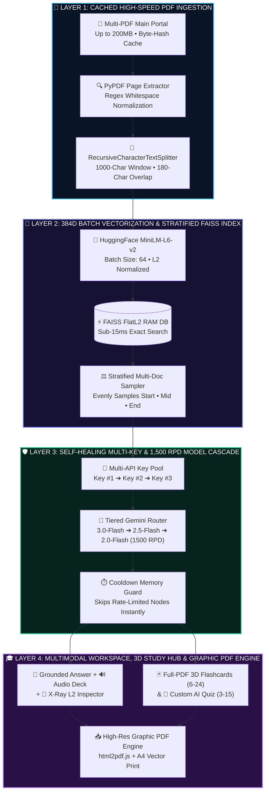
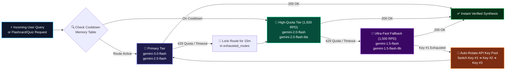
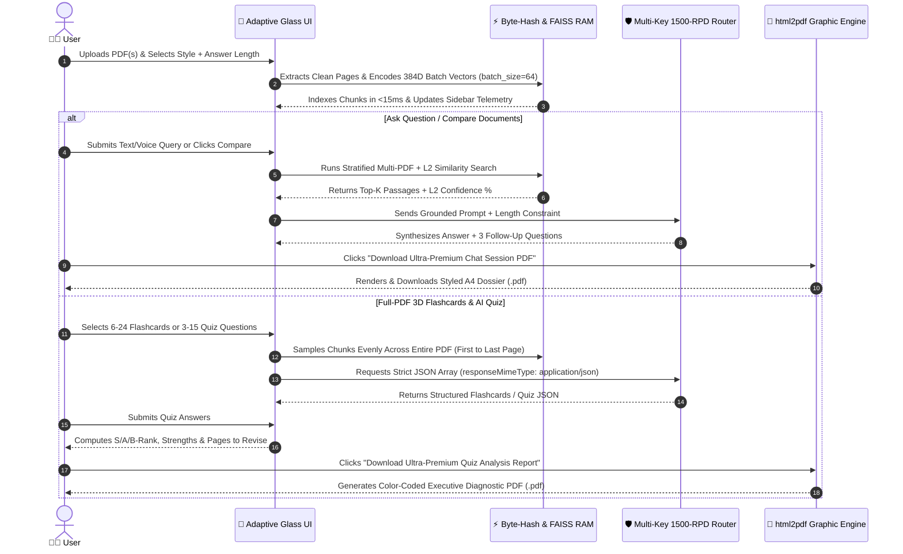
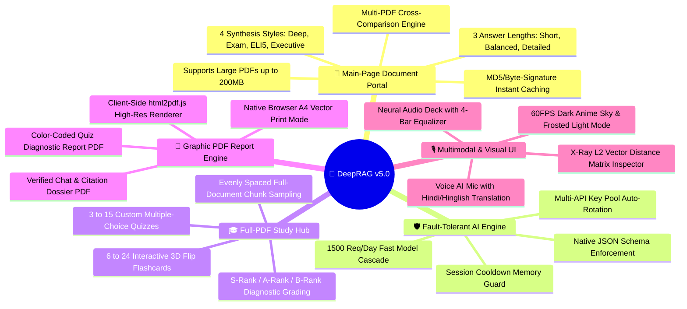

<div align="center">

<!-- 🌌 FUTURISTIC ANIMATED WAVING HEADER BANNER -->


<!-- ⌨️ ANIMATED NEON TYPING SVG -->
<a href="https://git.io/typing-svg">
  
</a>

<br/>

<!-- 🛡️ CYBERNETIC STATUS & TECH STACK BADGES -->
[](https://rirag-ai.streamlit.app/)
[](https://www.python.org/)
[](https://faiss.ai/)
[](https://ai.google.dev/)
[](https://huggingface.co/)
[](https://www.langchain.com/)
[](https://t.me/DeepRAGAI)

</div>

---

## ⚡ Executive Overview

**DeepRAG AI Workspace** is a production-grade **Retrieval-Augmented Generation (RAG)** and **Active Recall Study Platform** engineered to eliminate LLM hallucinations across large PDF textbooks, research papers, and technical manuals.

Unlike conventional wrappers that crash on API rate limits or retrieve incomplete context, DeepRAG combines **cached batch 384D vector indexing (`FAISS`)**, **stratified full-document sampling**, a **self-healing Multi-API Key & 1,500 RPD model cascade**, and a **client-side vector graphic PDF report generator (`html2pdf.js`)** inside an adaptive **60FPS Dark Anime / Frosted Light UI**.

---

## 🖥️ Futuristic HUD Interface Blueprint

```text
╔══════════════════════════════════════════════════════════════════════════════════════════════╗
║  🧠 DEEPRAG AI WORKSPACE                                    [⚙️ Sidebar] [🌑 Dark / ☀️ Light] ║
╠══════════════════════════════════════════════════════════════════════════════════════════════╣
║  [🚀 AI Workspace]    [🎓 AI Quiz & 3D Flashcards]    [⚡ How It Works]    [👨‍💻 About Creator] ║
╠═════════════════════════════════════════════╦════════════════════════════════════════════════╣
║  📂 Upload Your PDF Document(s) (Up to 200MB)║  🎛️ Output Style: [⚡ Deep Analysis (Default) ▼]║
║  ┌───────────────────────────────────────┐  ║  📏 Answer Length:                             ║
║  │ 📄 B.Tech_AI_Syllabus.pdf (17.3 MB)   │  ║  ( ) ⚡ Short   (•) ⚖️ Balanced   ( ) 📚 Detailed║
║  └───────────────────────────────────────┘  ║                                                ║
╠═════════════════════════════════════════════╩════════════════════════════════════════════════╣
║   📄 INDEXED PDF PAGES: 48         🧩 NEURAL VECTOR CHUNKS: 214        ⚡ ENGINE: FAISS Active ║
╠══════════════════════════════════════════════════════════════════════════════════════════════╣
║  ✨ [📝 Executive Summary] [🔑 Key Formulas] [🗺️ Concept Flowchart] [⚖️ Compare] [🎓 Top 5 Q&A]║
╠══════════════════════════════════════════════════════════════════════════════════════════════╣
║  🧠 Verified Neural Synthesis [Page 4] [Page 19]                                             ║
║  ┌────────────────────────────────────────────────────────────────────────────────────────┐  ║
║  │ 🔊 [⏸️ Pause Audio]  ▂▅▇▃  [⏹️ Stop]  [⚡ 1.25x]  [📋 Copy]     🎯 96% Semantic Match   │  ║
║  └────────────────────────────────────────────────────────────────────────────────────────┘  ║
║  ▸ 📚 View Verified PDF Page Citations & Animated Semantic Confidence Bars                   ║
║  ▸ 🔬 X-Ray RAG Telemetry & Vector Space Inspector (L2 Distance Matrix & Token Count)        ║
║  ┌────────────────────────────────────────────────────────────────────────────────────────┐  ║
║  │ 📥 Download Ultra-Premium Chat Session PDF (.pdf)             [🖨️ Save Vector PDF]     │  ║
║  └────────────────────────────────────────────────────────────────────────────────────────┘  ║
╚══════════════════════════════════════════════════════════════════════════════════════════════╝
```

---

## 🏗️ 1. Master System Architecture & Neural Pipeline



---

## 🔄 2. Zero-Downtime Multi-API Key & 1,500 RPD Auto-Failover Engine

DeepRAG eliminates `HTTP 429 Quota Exceeded` and `Read Timeout` errors using a **Two-Dimensional Failover Matrix** that automatically shifts across both **Model Tiers** and **Backup API Keys** while remembering exhausted routes in session memory:



---

## 🧬 3. Real-Time Execution & Graphic PDF Generation Sequence



---

## 🎓 4. Active Recall Study Hub & Diagnostic PDF Architecture

```text
┌──────────────────────────────────────────────────────────────────────────────────────────┐
│  🎓 AI QUIZ & FULL-PDF 3D FLASHCARDS                                                     │
├────────────────────────────────────────────┬─────────────────────────────────────────────┤
│  🃏 Full-Document 3D Flashcard Deck        │  🎯 Custom AI Exam & Quiz Generator         │
│  Slider: [━━━━━━━●━━━━━━━] 12 Cards (6-24) │  Slider: [━━━━━●━━━━━━━━━] 5 Questions (3-15│
│  [ 🃏 Generate Full-PDF 3D Flashcards ]    │  [ 🎯 Generate Custom AI Practice Quiz ]    │
├────────────────────────────────────────────┴─────────────────────────────────────────────┤
│  📊 EXECUTIVE QUIZ PERFORMANCE & DIAGNOSTIC REPORT                                       │
│  ┌────────────────────────┐   ┌────────────────────────┐   ┌──────────────────────────┐  │
│  │ 🎯 FINAL SCORE: 5 / 5  │   │ 📈 ACCURACY: 100%      │   │ 🏅 TIER: 🏆 S-Rank       │  │
│  └────────────────────────┘   └────────────────────────┘   └──────────────────────────┘  │
│  ✅ Strengths (Topics Mastered)            │  📌 Action Plan (Pages to Revise)           │
│  • 🟢 Vector Similarity Math (Page 1)      │  • 🎉 Zero weak spots! 100% Mastery!        │
│  • 🟢 FAISS FlatL2 Indexing (Page 3)       │                                             │
│  ┌────────────────────────────────────────────────────────────────────────────────────┐  │
│  │ 📥 Download Ultra-Premium Quiz Analysis Report (.pdf)       [🖨️ Save Vector PDF]   │  │
│  └────────────────────────────────────────────────────────────────────────────────────┘  │
└──────────────────────────────────────────────────────────────────────────────────────────┘
```

---

## 🧠 5. Complete DeepRAG Capability Mindmap



---

## 📐 Mathematical Formulation & Retrieval Algorithms

### 1. Normalized 384-Dimensional Dense Embedding
Every extracted PDF chunk $c_i \in \mathcal{C}$ and user query $q$ is mapped to the unit hypersphere in $\mathbb{R}^{384}$ via the `all-MiniLM-L6-v2` transformer encoder $E(\cdot)$:

$$\hat{\mathbf{v}}_q = \frac{E(q)}{\Vert{}E(q)\Vert{}_2}, \quad \hat{\mathbf{v}}_{c_i} = \frac{E(c_i)}{\Vert{}E(c_i)\Vert{}_2} \in \mathbb{R}^{384}$$

### 2. FAISS FlatL2 Squared Euclidean Distance
FAISS indexes all vectors in contiguous C++ RAM (`IndexFlatL2`) and computes exact squared $L_2$ distances:

$$d_{L_2}^2(\hat{\mathbf{v}}_q, \hat{\mathbf{v}}_{c_i}) = \left\Vert{} \hat{\mathbf{v}}_q - \hat{\mathbf{v}}_{c_i} \right\Vert{}_2^2 = \sum_{d=1}^{384} \left( \hat{v}_{q,d} - \hat{v}_{c_i,d} \right)^2$$

### 3. Semantic Match Confidence Calibration
Raw $L_2$ distances are transformed into bounded semantic confidence percentages displayed in the UI progress bars:

$$\text{Confidence}(\%) = \text{clip}\left( \text{round}\left( \frac{100}{1 + 0.35 \cdot d_{L_2}^2(\hat{\mathbf{v}}_q, \hat{\mathbf{v}}_{c_i})} \right), \, 68, \, 99 \right)$$

### 4. Stratified Full-Document Sampling (For Flashcards, Quizzes & Comparisons)
To ensure flashcards and quizzes cover the **entire PDF** from the first page to the last page rather than clustering around a single chapter, DeepRAG selects $M$ evenly spaced chunk indices across $N$ total chunks:

$$k_j = \min\left( N - 1, \, \text{round}\left( j \cdot \frac{N - 1}{\max(1, M - 1)} \right) \right), \quad \forall j \in \{0, 1, \dots, M-1\}$$

---

## 🛠️ Enterprise Feature & Technology Matrix

| Subsystem | Technology / Algorithm | Engineering Advantage |
| :--- | :--- | :--- |
| **Frontend & Motion UI** | Streamlit + Custom CSS3 + HTML5 2D Canvas | Zero-lag 60FPS Dark Anime night sky & auto-synced Frosted Light theme |
| **PDF Ingestion** | `pypdf` + `@st.cache_data` + `io.BytesIO` | Instant cached extraction with live progress bar for large PDFs |
| **Semantic Chunking** | LangChain `RecursiveCharacterTextSplitter` | 1,000-character windows with 180-character sliding overlap |
| **Vector Embeddings** | HuggingFace `all-MiniLM-L6-v2` (`batch_size=64`) | Local CPU batch encoding with zero external embedding API latency |
| **Vector Database** | Meta `FAISS` (`IndexFlatL2`) + Stratified Sampler | Sub-15ms retrieval + balanced multi-document comparison sampling |
| **LLM Failover Router** | Google Gemini Multi-Key + 1,500 RPD Cascade | Auto-rotates keys & shifts to high-quota Flash models on 429/timeout |
| **PDF Report Generator** | `html2pdf.js` + A4 Print CSS Engine | Generates graphic executive PDF reports for both Quizzes & Chat History |

---

## 🚀 Quickstart & Multi-Key Deployment Guide

### 1. Clone the Repository
```bash
git clone [https://github.com/deeprxx/VeriRAG.git](https://github.com/deeprxx/VeriRAG.git)
cd VeriRAG
```

### 2. Install Dependencies
```bash
pip install -r requirements.txt
```

### 3. Configure Multi-API Key Auto-Rotation (`secrets.toml`)
Create `.streamlit/secrets.toml` locally (or paste inside **Streamlit Cloud → Settings → Secrets**). Adding 2 or 3 keys enables automatic seamless failover when one key hits its daily quota:

```toml
GEMINI_API_KEY = "AIzaSy_YOUR_PRIMARY_GEMINI_KEY"
GEMINI_API_KEY_2 = "AIzaSy_YOUR_BACKUP_GEMINI_KEY_2"
GEMINI_API_KEY_3 = "AIzaSy_YOUR_BACKUP_GEMINI_KEY_3"
```

### 4. Launch DeepRAG Workspace
```bash
streamlit run app.py
```

---

## 📂 Repository Structure

```text
VeriRAG/
├── app.py                  # Complete application: Adaptive UI, Multi-Key RAG Router, 3D Study Hub & PDF Engine
├── requirements.txt        # Production Python dependencies for Streamlit Cloud deployment
└── README.md               # Visual architecture blueprints, math formulations & deployment guide
```

---

## 👨‍💻 About The Creator

<div align="center">


**Creator of DeepRAG AI Workspace**

> *"My mission is simple: transform complex artificial intelligence and neural retrieval pipelines into a fast, reliable, and visually breathtaking workspace that empowers students, researchers, and innovators worldwide."*

[](https://t.me/DeepRAGAI)
[](https://rirag-ai.streamlit.app/)

</div>

<!-- 🌌 FUTURISTIC ANIMATED WAVING FOOTER -->

