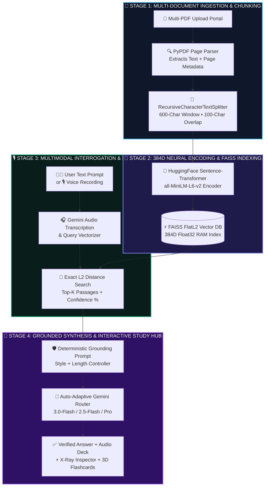
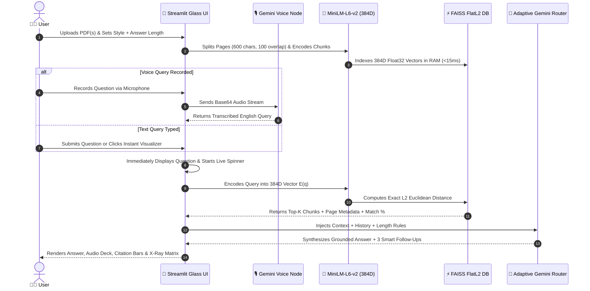
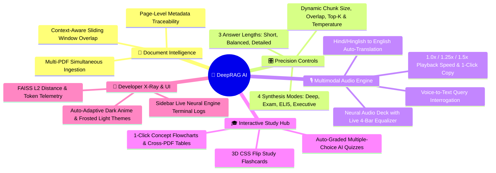

<div align="center">

<!-- DYNAMIC ANIMATED HEADER WAVE & TITLE -->


<!-- ANIMATED TYPING SVG SUBTITLE -->
<a href="https://git.io/typing-svg">
  
</a>

<br/>

<!-- TECH STACK & LIVE STATUS BADGES -->
[](https://rirag-ai.streamlit.app/)
[](https://www.python.org/)
[](https://www.langchain.com/)
[](https://faiss.ai/)
[](https://ai.google.dev/)
[](https://huggingface.co/)
[](https://t.me/DeepRAGAI)

</div>

---

## ⚡ Overview: Why DeepRAG AI Workspace?

Standard Large Language Models rely on static parametric memory, leading to **hallucinations** and an inability to verify facts across private documents. **DeepRAG AI Workspace** solves this by pairing **non-parametric dense vector retrieval (FAISS)** with **auto-adaptive Gemini synthesis** inside a zero-lag, adaptive Dark/Light glassmorphic interface.

```text
┌──────────────────────────────────────────────────────────────────────────────────────────┐
│  🧠 DEEPRAG AI WORKSPACE                                         [🌑 Dark / ☀️ Light]   │
├──────────────────────────────────────────────────────────────────────────────────────────┤
│  [🚀 AI Workspace]   [🎓 AI Quiz & 3D Flashcards]   [⚡ How It Works]   [👨‍💻 Creator]     │
├──────────────────────────────────────────┬───────────────────────────────────────────────┤
│  📂 Upload Your PDF Document(s)          │  🎛️ Output Style: [⚡ Deep Analysis        ▼] │
│  [ + Drag & Drop Multiple PDFs Here ]    │  📏 Length: ( ) Short  (•) Balanced  ( ) Deep │
├──────────────────────────────────────────┴───────────────────────────────────────────────┤
│  📄 INDEXED PDF PAGES: 42       🧩 NEURAL VECTOR CHUNKS: 186      ⚡ ENGINE: FAISS Active │
├──────────────────────────────────────────────────────────────────────────────────────────┤
│  ✨ [📝 Summary]  [🔑 Formulas]  [🗺️ Concept Flowchart]  [⚖️ Compare]  [🎓 Top 5 Q&A]    │
├──────────────────────────────────────────────────────────────────────────────────────────┤
│  🧠 Verified Synthesis [Page 4] [Page 12]                                                │
│  ┌────────────────────────────────────────────────────────────────────────────────────┐  │
│  │ 🔊 [⏸️ Pause Audio]  ▂▅▇▃  [⏹️ Stop]  [⚡ 1.25x]  [📋 Copy]   🎯 96% Semantic Match │  │
│  └────────────────────────────────────────────────────────────────────────────────────┘  │
│  ▸ 📚 View Verified PDF Page Citations & Semantic Confidence Bars                        │
│  ▸ 🔬 X-Ray RAG Telemetry & Vector Space Inspector (L2 Distance Matrix)                  │
└──────────────────────────────────────────────────────────────────────────────────────────┘
```

---

## 🏗️ 1. End-to-End Neural RAG Architecture



---

## 🔄 2. Real-Time Execution Sequence Diagram



---

## 🧩 3. Complete Feature Ecosystem



---

## 📐 Mathematical Formulation: Dense Vector Retrieval

### 1. Semantic Vector Encoding
Every extracted document chunk $d_i \in \mathcal{D}$ and user query $q$ is projected into a 384-dimensional dense vector space using the `all-MiniLM-L6-v2` transformer encoder $E: \mathcal{T} \rightarrow \mathbb{R}^{384}$:

$$\mathbf{v}_q = E(q), \quad \mathbf{v}_{d_i} = E(d_i) \in \mathbb{R}^{384}$$

### 2. FAISS FlatL2 Distance & Cosine Similarity
FAISS indexes normalized 384D vectors and computes the squared Euclidean ($L_2$) distance across all chunks in RAM:

$$d_{L_2}(\mathbf{v}_q, \mathbf{v}_{d_i}) = \left\Vert{} \mathbf{v}_q - \mathbf{v}_{d_i} \right\Vert{}_2^2 = \sum_{k=1}^{384} \left( v_{q,k} - v_{d_i,k} \right)^2$$

### 3. Semantic Match Confidence Calibration
To provide transparent verification in the UI citation bars and X-Ray Inspector, raw $L_2$ distances are mapped to a bounded semantic confidence percentage:

$$\text{Confidence}(\%) = \text{clip}\left( \text{round}\left( \frac{100}{1 + 0.35 \cdot d_{L_2}(\mathbf{v}_q, \mathbf{v}_{d_i})} \right), \, 65, \, 99 \right)$$

---

## 🔥 Core Engineering Highlights

| Module | Feature | Technical Implementation |
| :--- | :--- | :--- |
| **📂 Main-Page Portal** | Intuitive PDF Upload & Length Control | Direct main-view uploader with `Short & Crisp`, `Balanced`, and `Detailed` radio controllers |
| **🌗 Adaptive Theme Engine** | Auto-Sync Dark & Light Modes | Real-time DOM computed-style observer switching between 60FPS Anime Night Sky & Frosted Light UI |
| **🎧 Neural Audio Deck** | Interactive Speech Synthesis | Browser `speechSynthesis` deck with Play/Pause/Resume, animated CSS soundwave bars & speed toggle |
| **🔬 X-Ray RAG Inspector** | Transparent Vector Telemetry | Displays per-chunk $L_2$ distances, retrieval latency (`ms`), injected token counts, and keyword highlights |
| **🃏 3D Study Hub** | Active Recall & Self-Testing | Structured JSON prompting generating 180° 3D CSS flip flashcards and auto-graded MCQ quizzes |
| **🛡️ Auto-Adaptive Router** | Zero-Downtime Gemini Routing | Dynamically queries `/v1beta/models` at runtime and falls back across active Flash/Pro models |

---

## 🚀 Local Installation & Quickstart

### 1. Clone the Repository
```bash
git clone [https://github.com/deeprxx/VeriRAG.git](https://github.com/deeprxx/VeriRAG.git)
cd VeriRAG
```

### 2. Install Dependencies
```bash
pip install -r requirements.txt
```

### 3. Configure Your Gemini API Key
Create `.streamlit/secrets.toml` in your project root directory:
```toml
GEMINI_API_KEY = "your_google_gemini_api_key_here"
```

### 4. Launch the Application
```bash
streamlit run app.py
```

---

## 📁 Repository Structure

```text
VeriRAG/
├── app.py                  # Core application: Adaptive UI, FAISS RAG Engine, Voice AI & 3D Study Hub
├── requirements.txt        # Production Python dependencies for Streamlit Cloud
└── README.md               # System architecture, mathematical formulation & documentation
```

---

## 👨‍💻 About The Creator

<div align="center">

### **Deep Patel**
**Founder, Lead AI Architect & Creator of DeepRAG AI Workspace**

> *"My mission is simple: transform complex artificial intelligence and neural retrieval pipelines into a fast, reliable, and visually breathtaking workspace that empowers students, researchers, and innovators."*

[](https://t.me/DeepRAGAI)

</div>

<!-- DYNAMIC ANIMATED FOOTER WAVE -->

