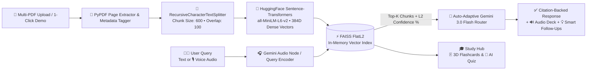

<div align="center">

# 🧠 DeepRAG AI Workspace
### **Enterprise Neural RAG, Multimodal Voice AI & Interactive Document Intelligence**

[](https://deep-verirag-ai.streamlit.app/)
[](https://www.python.org/)
[](https://www.langchain.com/)
[](https://faiss.ai/)
[](https://ai.google.dev/)
[](https://t.me/DeepRAGAI)

*Transform static PDF textbooks, research papers, and technical manuals into an interactive, hallucination-free neural knowledge base with millisecond vector retrieval, voice interrogation, and 3D study tools.*

</div>

---

## ✨ Key Highlights & Enterprise Capabilities

* **🔍 Zero-Hallucination Grounding & Page Citations:** Every answer is synthesized strictly from uploaded PDF context with inline page citations (`[Page X]`), keyword highlighting, and animated semantic match confidence bars (`%`).
* **🎙️ Multimodal Voice AI (Speech-to-Text & Neural Audio Deck):** Ask questions in English, Hindi, or Hinglish via microphone recording and listen to synthesized answers using a custom audio deck featuring Play/Pause/Resume, a live 4-bar equalizer, and playback speed controls (`1.0x`, `1.25x`, `1.5x`).
* **⚡ 1-Click Instant Demo Mode:** Built-in 5-page *DeepRAG Technical Whitepaper* allows instant testing of vector retrieval, citations, flowcharts, and quizzes without uploading a file.
* **🃏 Interactive Study Hub (3D Flip Flashcards & AI Quiz):** Automatically generates interactive 3D CSS flip flashcards and auto-graded multiple-choice practice quizzes directly from indexed vector chunks.
* **🔬 X-Ray RAG Telemetry & Live System Logs:** Inspect real-time **FAISS FlatL2 Euclidean distances**, sub-15ms vector retrieval latency, context token counts, and live engine execution logs.
* **🗺️ 1-Click Neural Visualizers:** Generate executive summaries, key formulas, Unicode concept flowcharts, and multi-PDF cross-comparison tables in a single click.
* **🎨 Zero-Lag Dark Anime Glassmorphism UI:** Engineered with a custom 60FPS HTML5 night-sky & rising shadow-ember canvas paired with responsive glassmorphic cards.

---

## 🏗️ System Architecture & Neural Pipeline



---

## 📐 Mathematical Formulation (Vector Retrieval)

DeepRAG maps every document chunk $d \in D$ and user query $q$ into a 384-dimensional dense Euclidean space $\mathbb{R}^{384}$ using the `all-MiniLM-L6-v2` transformer encoder $E(\cdot)$:

$$\text{sim}(q, d) = \frac{E(q) \cdot E(d)}{\Vert{}E(q)\Vert{}_2 \, \Vert{}E(d)\Vert{}_2}$$

FAISS computes exact $L_2$ squared distances $d_{L2}(q, d) = \Vert{}E(q) - E(d)\Vert{}_2^2$ across all indexed chunks in milliseconds and converts the distance into an intuitive semantic confidence score:

$$\text{Confidence (\%)} = \text{clip}\left( \text{round}\left(\frac{100}{1 + 0.35 \cdot d_{L2}(q, d)}\right), \, 65, \, 99 \right)$$

---

## 🛠️ Technology Stack

| Layer | Technology | Role in DeepRAG Architecture |
| :--- | :--- | :--- |
| **Frontend & UI** | Streamlit + Custom CSS3 / HTML5 Canvas | Glassmorphic interface, 3D flashcards & 60FPS particle canvas |
| **LLM Synthesis** | Google Gemini (`gemini-3.0-flash` / `2.5-flash`) | Auto-adaptive grounded synthesis, quiz JSON & voice transcription |
| **Vector Database** | Facebook AI Similarity Search (`FAISS`) | High-speed in-memory $L_2$ nearest-neighbor vector indexing |
| **Embeddings** | HuggingFace `all-MiniLM-L6-v2` | 384-dimensional dense semantic text encoding |
| **Orchestration** | LangChain + `pypdf` | Context-aware recursive chunking & page-level metadata tagging |

---

## 🚀 Local Installation & Setup

### 1. Clone the Repository
```bash
git clone [https://github.com/deeprxx/VeriRAG.git](https://github.com/deeprxx/VeriRAG.git)
cd VeriRAG
```

### 2. Install Dependencies
```bash
pip install -r requirements.txt
```

### 3. Configure Your API Key Securely
Create a `.streamlit/secrets.toml` file in the root directory and add your Google Gemini API key:
```toml
GEMINI_API_KEY = "your_google_gemini_api_key_here"
```

### 4. Launch the Workspace
```bash
streamlit run app.py
```

---

## 📂 Project Structure

```text
VeriRAG/
├── app.py                  # Main application, UI engine, RAG pipeline & Voice AI
├── requirements.txt        # Python dependencies for Streamlit Cloud deployment
└── README.md               # Architecture documentation & setup guide
```

---

## 👨‍💻 About the Creator

**Deep Patel**  
*Founder, Lead AI Architect & Creator of DeepRAG AI Workspace*

> *"My mission is simple: transform complex artificial intelligence and neural retrieval pipelines into a fast, reliable, and visually breathtaking workspace that empowers students, researchers, and innovators."*

* **📞 Contact Us:** Telegram [@DeepRAGAI](https://t.me/DeepRAGAI)

---

<div align="center">
  <strong>Engineered with ❤️ by Deep</strong>
</div>
